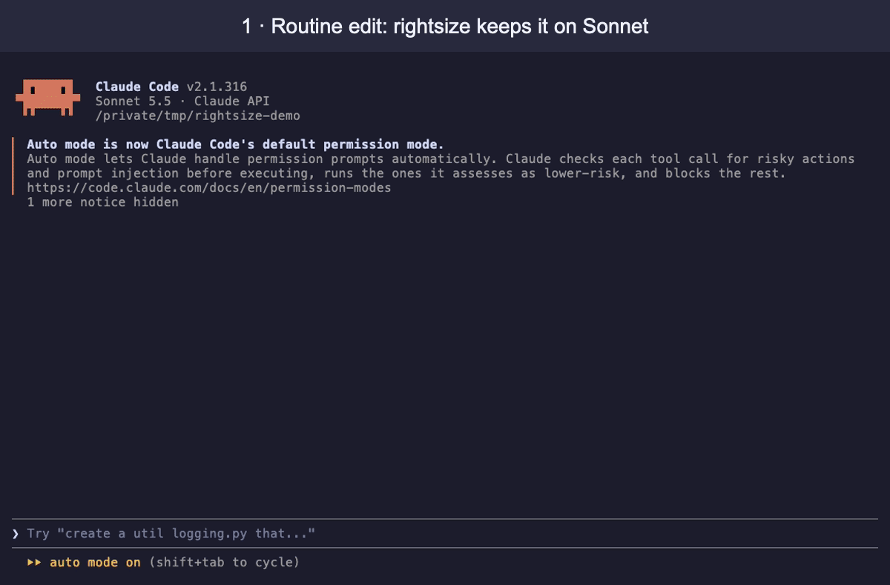

# rightsize

**Make every Claude token count.**

rightsize picks the model and effort for each prompt, and keeps your cache and context from costing more than they should.



```bash
claude plugin marketplace add archid21/rightsize
claude plugin install rightsize@archid21 --scope user
```

MIT license · works with a Claude subscription (Pro, Max, Ultra) or an API key · [Open an issue](https://github.com/archid21/rightsize/issues)

---

## Why use it

**Same outcome, lower cost (starting on Opus).** rightsize routes routine work to cheaper models and lower effort, and keeps Opus for the work that needs it. On our coding benchmark it matched Opus at up to 30% lower cost (API-equivalent).

**Higher quality (starting on Sonnet).** rightsize steps up to Opus as needed, for reviews and other work that needs it. If your default is Sonnet, you may spend more: on our coding benchmark, about 1.4x to 2x what Sonnet alone costs, almost all of it from reviews that run on Opus. In return you get stronger reviews without switching models yourself. Your cost depends on how many reviews you run.

If your default is Opus, moving to Sonnet with rightsize cut cost by about 30% and matched Opus on our coding benchmark.

**Less manual switching.** rightsize chooses the model and effort for each prompt, so you only switch to Opus or Fable yourself when you know a task is truly complex.

**Cut cache and compact costs.** Stop paying to rewrite a cold cache or re-read a long conversation. rightsize keeps the cache warm when that is cheaper, warns as your context fills, and compacts only when the saving outweighs the cost.

**rightsize works better with whatsnext.** rightsize decides when a compact pays. [whatsnext](https://github.com/archid21/whatsnext) decides what to keep: it saves a handoff note first, so a compact retains the details that matter, and it can compact closed threads for you. rightsize works on its own too, and uses Claude's own compact when whatsnext isn't installed.

## The problem: one model for every prompt

Claude Code runs every prompt on the model you picked, at the effort you picked. So you pay one of two prices:

- **Opus on everything.** Renaming a variable costs as much as reviewing a pull request. On Pro you hit your 5-hour limit before lunch; on Max and Ultra you still run into the weekly cap.
- **Sonnet on everything.** Your usage lasts, but the work that needs Opus most, reviews and hard bugs, gets a weaker answer.

Switching by hand with `/model` works until you forget, which is most of the time.

## What you get

| Feature | What it delivers | How to use it |
|---|---|---|
| Smart routing | Routine work on cheaper models, Opus where it counts | Automatic. Pick a **Profile** in `/config`. |
| Effort control | Lower effort for easy prompts, higher for hard ones | Automatic. The **Lowering** and **Raising** rows set ask, automatic or never. |
| Cheaper helpers | Big routine edits handled at lower cost | Automatic from Opus or Fable sessions. Press **Run on your model** on the band to undo one. |
| Opus reviews | Stronger reviews without switching models | Automatic. The **Stronger model** row sets ask first or always send. |
| Watch only | See what rightsize would save before it changes anything | Set **Mode** to watch only, then run `/rightsize report` after a week. |
| Keep warm | Avoid paying to rewrite a cold cache | Set **Before the cache goes cold**, or pick a time when the band offers it. |
| Context-size warning | Compact before the conversation gets costly | Appears at 40–90% full. Press **Compact now**. |
| Compact before your 5-hour limit | Save usage after a window reset | Press **Compact now** when the band advises it. |
| Handoff before a compact ★ | A compact that retains the details that matter | Install whatsnext. rightsize asks it automatically. |
| Closed-thread compacting ★ | Cheaper returns to old threads | Press **Turn on** on the cold-return note, then confirm. |
| Cost report ★ | Measured savings, spend and return rate | Run `/rightsize report`. (★ for the Closed compacts line only.) |
| Band and settings | See and change every decision | Use the band's buttons and ⋯ menu, `/config`, or `/rightsize settings`. |

★ Needs whatsnext.

**Opus results, without Opus prices.** Before each prompt runs, a quick rating decides what kind of work it is. Routine work stays on Sonnet. Reviews switch to Opus at high effort for that one turn, then your chat goes back.

**More from your plan.** On Pro, Max and Ultra, rightsize watches your usage windows (weekly, and 5-hour where your plan has one) and saves harder as you run low. Opus allowance goes to the work that needs it.

**Big routine jobs, done cheaper.** Working on Opus? A large, mechanical job such as the same edit across many files can go to a Haiku helper. Your main chat writes the brief, checks the result against it, and sends it back if anything is off. On our benchmark these hand-offs passed as often as Opus at a bit under half the cost. rightsize hands off only when the brief and the check still leave a saving, so from a Sonnet session it never does.

**Come back to a warm session.** A long session is cheap only while its prompt cache (the stored copy of your conversation) is warm. Step away past the cache's hour and your next prompt pays to rebuild it. rightsize keeps a big session warm while you are away, for as long as your profile says, and never past the point where coming back cold would be cheaper. When keeping warm over your usual idle time would cost at least 3 times a compact, rightsize compacts instead.

| Coming back to a 150k-token Opus session | Cost at API prices |
|---|---|
| Cold: the conversation is written to the cache again | About $1.20 |
| Kept warm for 8 hours: one cheap cache read per hour | About $0.25 |

On a subscription, the rebuild doesn't eat into your usage window. The band shows `Warm until 8:30 · $0.00 so far`, with a Stop button.

**Compact before it costs you.** As a conversation fills the window, the band says so at 40, 50, 60, 70, 80 and 90%, skipping any point where Claude Code would compact by itself. Near your 5-hour limit it advises a compact while the cache is warm. Nothing compacts until you press the button.

**Come back to old threads cheaper.** Most closed threads are never reopened, so rightsize compacts only when the saving outweighs the cost. When you resume a session after its cache expired, the band says what a compact beforehand would have saved. **Turn on** opens a dialog with the limit (up to 5 closed threads a day) and the cost, and nothing starts until you confirm. Needs whatsnext.

**Cost you can see.** A band above the prompt says what rightsize did and why. `/rightsize report` shows what each choice cost against staying on your own model, including the times it cost more. The report also shows how many sessions came back to a cold cache and, with whatsnext, what its closed-thread compacts spent, saved and how many came back.

**Safe to try.** Watch-only mode rates every prompt and changes nothing, so you can see its calls on your own work first.

| | Opus on everything | Sonnet on everything | Sonnet + rightsize |
|---|---|---|---|
| Results on our benchmark | Baseline | Fewer tasks passed | Matched Opus |
| Cost | Highest | Lowest | About 30% less than Opus |
| Reviews | Opus | Sonnet | Opus, for that turn |
| Remembering to switch | You | You | rightsize |

*Benchmark: real tasks from open-source repositories, each graded by hidden tests the model never sees. Your results depend on your work and settings. Method: [docs/METHOD.md](docs/METHOD.md).*

## Quickstart

**You need** Claude Code 2.1.287 or newer (2.1.286 in the desktop app) and a Claude subscription or API key. Nothing else.

1. Install:

   ```bash
   claude plugin marketplace add archid21/rightsize
   claude plugin install rightsize@archid21 --scope user
   ```

2. Start a new session and type `/rightsize`. If the settings pane opens, it works.
3. On an Opus start, the band offers **Switch: /model sonnet** once. Press it, then Enter. rightsize never changes your model by itself.
4. Work as usual. After a few sessions, run `/rightsize report`.
5. Optional: install [whatsnext](https://github.com/archid21/whatsnext) for compacts that retain better information, and for closed-thread compacting.

Want to watch first? In `/config`, set **Mode** to watch only.

## How it works

1. **Rate.** When you send a prompt, a hook asks Sonnet at low effort what kind of work it is and which models would do it well. This takes about a second.
2. **Route.** rightsize keeps the prompt on your model, changes the effort level, switches to Opus for one turn, or hands the work to a helper subagent on a cheaper model. It acts only when its estimate says the choice pays.
3. **Check.** After the turn it records what happened: rework, a failing test, a reply you correct, your 👍 or 👎. A route that keeps missing for a kind of work is paused for that kind of work.
4. **Watch the cache and context.** At the end of a turn, rightsize checks the conversation's size and how long the cache will live. It can keep the cache warm, warn that the context is filling, or advise a compact. It acts only when its estimate says the choice pays, and it compacts only when you press a button.

**What leaves your machine.** Nothing goes to the author or to any third party. The rating runs through Claude Code with your own sign-in, like any other prompt. Logs stay in `~/.claude/mods-logs/rightsize/`. rightsize's only web request is a monthly fetch of Anthropic's pricing page (**Price check**, can be turned off): [docs/PRIVACY.md](docs/PRIVACY.md).

**What it costs to run.** Each rating adds about one second and a small Sonnet call before the prompt. The report counts that cost against the savings, so the totals you see are after rightsize's own cost.

**What it never does.** It never changes your model for you, never approves a tool call, never changes a permission, and never touches your project files. Hooks and file paths: [docs/WHAT-IT-TOUCHES.md](docs/WHAT-IT-TOUCHES.md).

**What it runs, writes and sends.** It runs `mkdir`, `chmod`, `rm` and `rmdir` on its own log folders, `find` and `tail` to read when a session's last reply came, and, with whatsnext installed, `git rev-parse` and whatsnext's own script. The script's commands read settings and logs; it writes whatsnext's settings only after you confirm **Turn on**. It writes only under `~/.claude/mods-logs/rightsize/`, its own store, and its own `prices.json`. Its only web request is to `platform.claude.com` (Anthropic's pricing page, monthly, sends nothing of yours); it sends nothing to the author. It sets only its own `rightsize.*` settings, submits only the fixed text `wrap up`, reads no credential, and its `tool.call` hook only ever denies, never approves. The full list, checked against the code: [What it runs, writes and sends](plugins/rightsize/README.md#what-it-runs-writes-and-sends).

## Make it yours

Pick a profile in `/config`. Balanced is the default.

| | Quality | Balanced | Economy |
|---|---|---|---|
| Moves to a cheaper model when | Your own log shows it works | The rating says it fits | It fits at all |
| Reviews on Opus | Yes, highest effort | Yes, highest effort | Stays, raises effort only |
| Keeps the cache warm while you're away | 8 hours | Until your usual start time | No |

When keeping warm over your usual idle time would cost at least 3 times a compact, the profile's keep warm becomes a compact instead. A **Before the cache goes cold** row you set yourself always wins.

**Recipes**

- **Opus reviews, but no helper subagents:** set **Hand-offs** to off.
- **Just effort, no model changes:** set **Stronger model** to stay and **Cheaper model** to stay.
- **Ask before anything changes:** set **Profile** to Quality, or set any of the four rules to ask me.

**Routing**, **Hand-offs** and **Cache** each turn one feature off. Every setting, with its options and default: [docs/SETTINGS.md](docs/SETTINGS.md). Every rule and number: [docs/HOW-IT-DECIDES.md](docs/HOW-IT-DECIDES.md).

## Commands

| Command | What it does |
|---|---|
| `/rightsize` | Settings pane |
| `/rightsize report` | What each choice cost and saved |
| `/rightsize status` | Your profile and the settings you changed |
| `/rightsize retry` | Runs the last lowered prompt at normal effort |
| `/mods` | Turns rightsize on or off |

All commands: `/rightsize help`.

## Update, pause, remove

```bash
claude plugin update rightsize@archid21
```

- **Pause:** `/mods`, or `claude plugin disable rightsize@archid21` (keeps your settings).
- **Remove:** `claude plugin uninstall rightsize@archid21`, then `rm -r ~/.claude/plugins/store/rightsize_*.json ~/.claude/mods-logs/rightsize*` to delete its data.

## Limits

- The rating is a model's estimate. It can be wrong on a single prompt; miss tracking corrects it over time.
- Hand-offs take longer than staying, because the helper adds a brief and a check. The band says so.
- If you already use Sonnet for everything, rightsize costs more than you pay now. What you get for it is Opus on reviews.
- Handoffs before a compact, closed-thread compacting and the Closed compacts report line need whatsnext. Without it, rightsize uses Claude's own compact.
- Automatic compacting of closed threads is off until you turn it on, and it can spend up to $0.50 a day (or 1M tokens of your usage windows on a subscription).
- The effort picker in the app does not move; the status line shows the level in use.

## Get involved

- ⭐ [Star the repo](https://github.com/archid21/rightsize) if it saves you usage.
- Found a bad call? [Open an issue](https://github.com/archid21/rightsize/issues) with the band text and `/rightsize status`.
- Using it, and want to say how it went? [Send feedback](https://github.com/archid21/rightsize/issues/new?template=feedback.md): what you use, what it did well or got wrong, and optionally your `/rightsize report`.
- Pull requests are welcome: [CONTRIBUTING.md](CONTRIBUTING.md).

Made by [Archi Dubey](https://github.com/archid21). An independent project, not made or endorsed by Anthropic. [MIT](LICENSE) © 2026.
