# rightsize

**Make every Claude token count.**

[](https://github.com/archid21/rightsize/releases/latest)
[](LICENSE)
[](#quickstart)

rightsize is a Claude Code plugin. It sends each prompt to the cheapest model and effort that does the job, raises effort only when Claude is stuck, and keeps the cache and context from costing more than they should. It logs every choice, learns how you work, and shows what each choice cost.

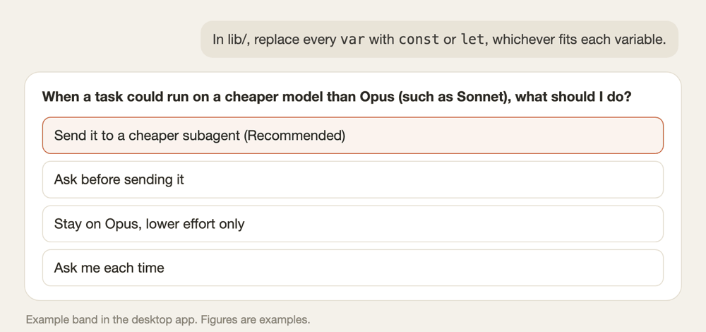

```bash
claude plugin marketplace add archid21/rightsize
claude plugin install rightsize@archid21 --scope user
```

Works with a Claude subscription (Pro, Max, Ultra) or an API key · MIT license · **New in 0.16.2:** a simpler band, a cache bar with the clock time, and the session total on the status line ([changelog](CHANGELOG.md)).

## Contents

[Why use it](#why-use-it) · [Quickstart](#quickstart) · [How it works](#how-it-works) · [What you'll see](#what-youll-see) · [Features](#features) · [Make it yours](#make-it-yours) · [Commands](#commands) · [Privacy and safety](#privacy-and-safety) · [FAQ](#faq) · [Limits](#limits) · [Get involved](#get-involved)

## Why use it

Claude Code runs every prompt on the model and effort you picked. On Opus, renaming a variable costs as much as reviewing a pull request, and you reach your usage limit early. On Sonnet, your usage lasts, but reviews and hard bugs get a weaker answer. Switching by hand with `/model` works until you forget.

- **From an Opus start: same results, lower cost.** Routine work goes to Haiku or Sonnet helpers and lower effort; Opus keeps the work that needs it. On our coding benchmark it matched Opus at up to 30% lower cost (API-equivalent).
- **From a Sonnet start: Opus-grade reviews.** Reviews switch to Opus for one turn, then come back. This costs more than Sonnet alone: on our benchmark about 1.4x to 2x, almost all of it from reviews.
- **Effort follows evidence.** Effort goes up mid-turn only when the turn shows trouble: repeated failures, a loop, or two fixes in a row that leave the tests red.
- **It learns which routes to trust.** Every hand-off, lowering, test run and 👍/👎 scores the rater per kind of work and model. A route that keeps missing is paused.
- **Cache and compact costs under control.** It keeps the cache warm only while your own record says that pays, warns as the context fills, and compacts only when you press a button or set a row to.

| | Opus on everything | Sonnet on everything | rightsize |
|---|---|---|---|
| Results on our benchmark | Baseline | Fewer tasks passed | Matched Opus |
| Reviews | Opus | Sonnet | Opus, for that turn |
| Routine work | Opus | Sonnet | Cheapest model that fits |
| Remembering to switch | You | You | rightsize |

*Benchmark: real tasks from open-source repositories, each graded by hidden tests the model never sees. Your results depend on your work and settings. Method: [docs/METHOD.md](docs/METHOD.md).*

## Quickstart

**You need** Claude Code 2.1.287 or newer (2.1.286 in the desktop app) and a Claude subscription or API key. The handoff compact text also needs `python3` (on a Mac it comes with the Xcode command line tools); without it a compact uses Claude Code's own summary.

1. Install with the two commands above.
2. Start a new session and type `/rightsize`. If the settings pane opens, it works.
3. On an Opus start, the band offers **Switch: /model sonnet** once. Press it, then Enter. rightsize never changes your saved default model.
4. Work as usual. After a few sessions, run `/rightsize report`.
5. Optional: install [whatsnext](https://github.com/archid21/whatsnext) for compacts that keep better notes.

**Want to watch first?** In `/config`, set **Mode** to watch only. rightsize rates every prompt and changes nothing; run `/rightsize report` after a week to see what it would have saved.

## How it works

1. **Rate.** When you send a prompt, a hook asks Sonnet at low effort what kind of work it is and which models would do it well. This takes about a second.
2. **Route.** rightsize keeps the prompt on your model, changes the effort, switches to Opus for one turn, or hands the work to a helper subagent on a cheaper model. It acts only when its estimate says the choice pays.
3. **Check.** After the turn it records what happened: rework, a failing test, a reply you correct, your 👍 or 👎. A route that keeps missing for a kind of work is paused.
4. **Watch the cache and context.** At the end of a turn it checks the conversation's size and how long the cache will live. It can keep the cache warm, warn that the context is filling, or advise a compact.

The report counts rightsize's own cost (the rating calls) against the savings, so the totals you see are after that cost. Every rule and number: [docs/HOW-IT-DECIDES.md](docs/HOW-IT-DECIDES.md).

## What you'll see

A band above the prompt says what rightsize did and why, with buttons to undo it; ▾ folds it to one line. Pictures of the desktop app; figures are examples.

**Changes: Auto (the default) acts and says so; Ask asks first.** On Ask, one question with the recommended choice first; after the same answer three times, **Always do this** saves it.

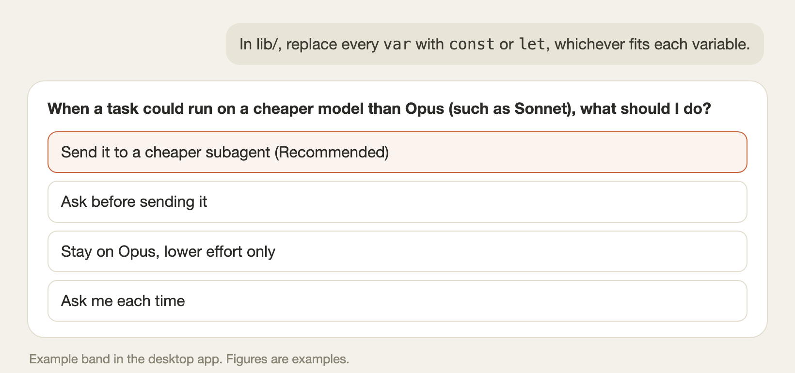

**A routine task goes to a Sonnet helper,** and the band shows what it saved, with one button to undo it.

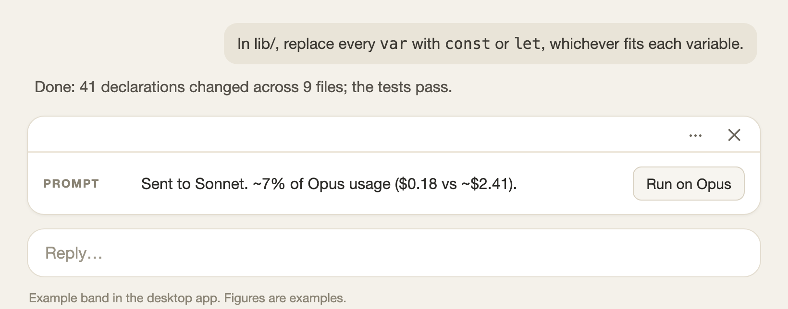

**Effort follows the work.** Low for a quick answer; raised mid-turn only when the turn shows trouble.

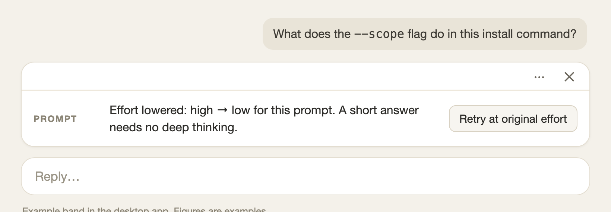

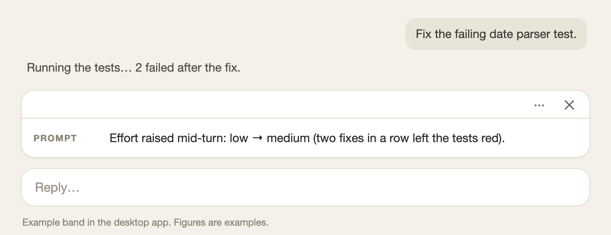

**Cache and context.** Keep the cache warm while you are away, or compact before the conversation gets costly.

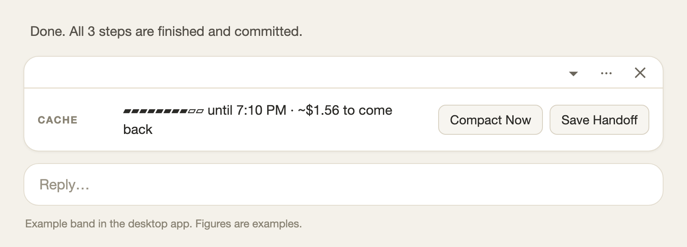

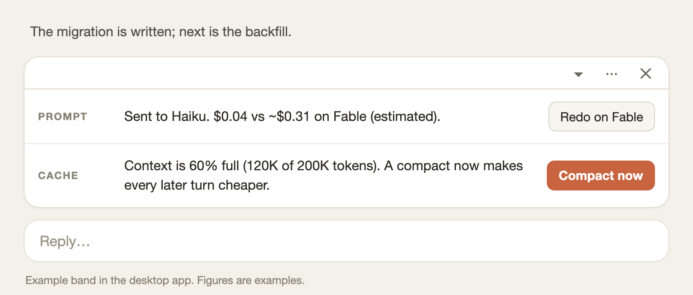

<details>
<summary>In the terminal</summary>

The same rows, one line each, with buttons below. Screenshots from a real session, with captions added.

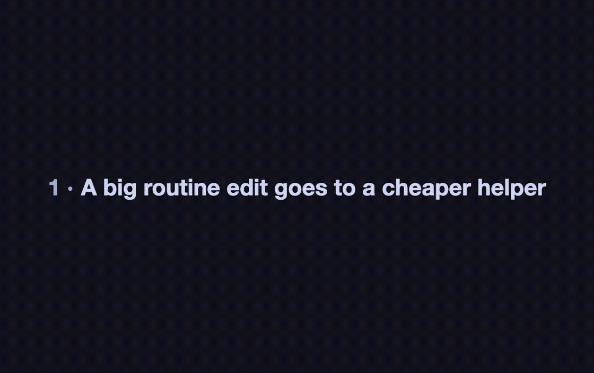

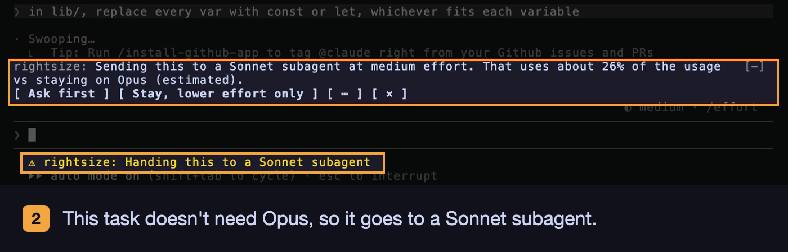

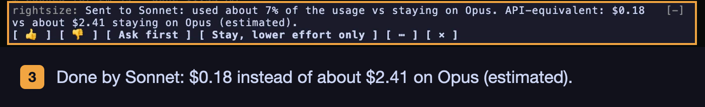

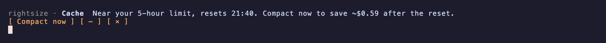

</details>

## Features

**Automatic**

| Feature | What it delivers |
|---|---|
| Smart routing | Routine work on cheaper models, Opus where it counts. **Changes** in `/config` (Auto or Ask) makes it ask first. |
| Effort control | Lower effort for routine prompts; raised mid-turn only when Claude is stuck. |
| Cheaper helpers | Big routine jobs (the same edit across many files) go to a Haiku or Sonnet helper. Your main chat writes the brief and checks the result. **Run on your model** on the band undoes one. |
| Opus reviews | Stronger reviews without switching models yourself. |
| Keep warm | Keeps a big session's cache warm while you are away, only while your record says it pays. |
| Usage windows | On Pro, Max and Ultra, saves harder as your weekly or 5-hour window runs low. |

**On request**

| Feature | How to use it |
|---|---|
| Cost report | `/rightsize report`: measured savings, spend, and the times rightsize cost more. |
| Settings suggestions | `/rightsize optimize`: changes priced on your last 30 days; you pick which to apply. |
| Compact now | Press it when the band warns the context is filling (40 to 90%) or you are near your 5-hour limit. |
| Wrap up | Press **Wrap up** on the countdown row, or type `wrap up`, to save a handoff note (or compact without whatsnext). |

**Works better with [whatsnext](https://github.com/archid21/whatsnext).** rightsize decides when a compact pays; whatsnext decides what to keep, by saving a handoff note first. Without whatsnext, rightsize compacts with its own handoff-style text.

Every feature, with the release that added it: [docs/FEATURES.md](docs/FEATURES.md).

## Make it yours

Two switches cover most needs. **Hand-offs** turns helper subagents off (effort still changes). **Changes** set to Ask makes every move ask first.

| | Default | Row |
|---|---|---|
| Moves to a cheaper model when | The rating says it fits and the helper costs under 90% of staying | **Cheaper model** |
| Lowers effort when | On Opus or Fable, every prompt but a review; elsewhere when the rating says the lower level fits | **Lowering** |
| Reviews on Opus | Yes, highest effort | **Stronger model** |
| Keeps the cache warm while you're away | Only while your own record says it pays | **Before the cache goes cold** |

**Recipes**

- **Opus reviews, but no helpers:** set **Hand-offs** to off.
- **Just effort, no model changes:** set **Stronger model** and **Cheaper model** to stay.
- **Ask before anything changes:** set **Changes** to Ask.

Every setting, with its options and default: [docs/SETTINGS.md](docs/SETTINGS.md).

## Commands

| Command | What it does |
|---|---|
| `/rightsize` | Settings pane |
| `/rightsize report` | What you saved, what rightsize did, and what to change |
| `/rightsize report details` | Accuracy, cache rebuilds by cause, time and whole tasks |
| `/rightsize optimize` | Setting changes from your last 30 days, priced both ways |
| `/rightsize status` | What is in use and the settings you changed |
| `/rightsize retry` | Runs the last lowered prompt at normal effort |
| `/rightsize help` | All commands |

**Update:** `claude plugin update rightsize@archid21`. **Pause:** `/mods`, or `claude plugin disable rightsize@archid21` (keeps your settings). **Remove:** `claude plugin uninstall rightsize@archid21`, then `rm -r ~/.claude/plugins/store/rightsize_*.json ~/.claude/mods-logs/rightsize*` to delete its data.

## Privacy and safety

- **Nothing goes to the author.** The rating runs through Claude Code with your own sign-in, like any other prompt. Logs stay in `~/.claude/mods-logs/rightsize/`.
- **Two web requests:** a monthly fetch of Anthropic's pricing page (**Price check**, can be turned off), and a GitHub star check through your own `gh` sign-in, only after rightsize has saved you something and until you answer it.
- **It never** changes your saved model, approves a tool call, changes a permission, reads a credential, or touches your project files.
- **It writes only** its own logs, store and settings. The full list of what it runs, writes and sends, checked against the code: [plugins/rightsize/README.md](plugins/rightsize/README.md#what-it-runs-writes-and-sends). More: [docs/PRIVACY.md](docs/PRIVACY.md), [docs/WHAT-IT-TOUCHES.md](docs/WHAT-IT-TOUCHES.md).

## FAQ

**Will it cost me more?** From an Opus start it is built to cost less. If you already use Sonnet for everything, it costs more, because reviews go to Opus; set **Stronger model** to stay to avoid that.

**Why didn't it lower or hand off this prompt?** It acts only when its estimate says the choice pays, and the band says why it kept your level. A route that missed too often is paused for a number of prompts.

**The rating was wrong. What now?** Press 👎 or correct the reply; rightsize counts that against the route. `/rightsize retry` reruns a lowered prompt at normal effort.

**Is the dollar figure my bill?** On a subscription, no: it is API-equivalent (what the same tokens would cost at API prices). The report also shows your share of each usage window.

**How do I check it is running?** Type `/rightsize`. If the settings pane opens, it works; `/rightsize status` shows what is in use.

## Limits

- The rating is a model's estimate. It can be wrong on a single prompt; miss tracking corrects it over time.
- Hand-offs take longer than staying, because the helper adds a brief and a check. The band says so.
- Older model versions (such as Opus 4.8) are priced by their own row in `prices.json`, and an effort change there rewrites the whole conversation. A version with no row pauses rightsize; `/rightsize prices` fetches the current list.
- rightsize compacts only the open session, and only when you press a button or set a row to compact.
- The effort picker in the app does not move; the status line shows the level in use.

## Get involved

- ⭐ [Star the repo](https://github.com/archid21/rightsize) if it saves you usage.
- Found a bad call? [Open an issue](https://github.com/archid21/rightsize/issues) with the band text and `/rightsize status`.
- Want to say how it went? [Send feedback](https://github.com/archid21/rightsize/issues/new?template=feedback.md).
- Pull requests are welcome: [CONTRIBUTING.md](CONTRIBUTING.md).

Made by [Archi Dubey](https://github.com/archid21). An independent project, not made or endorsed by Anthropic. [MIT](LICENSE) © 2026.
