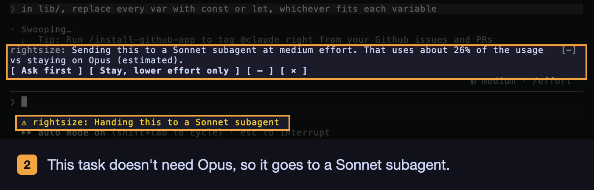
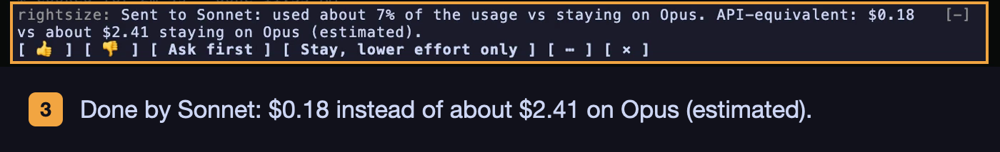
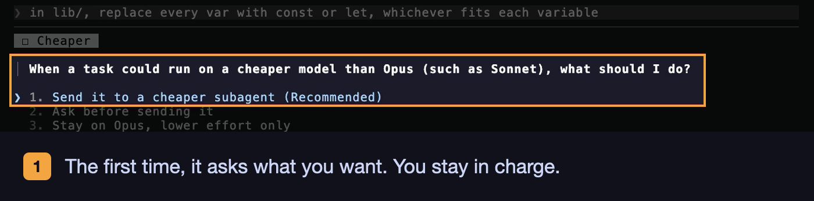

# rightsize

**A Claude Code mod that matches each prompt to the right model and effort level, so you don't pay Opus prices for Haiku work.**

Created by [Archi Dubey](https://github.com/archid21). MIT license.


*One demo run in the [Express](https://github.com/expressjs/express) repository. rightsize's choice depends on the task, your model and your settings, so yours may differ.*

## Before you use it

rightsize is a work in progress. It changes how Claude Code spends your tokens, and its choices are estimates. Savings are not guaranteed: some turns can cost more, not less, and a cheaper model can sometimes do weaker work. Use it at your own risk, and check `/rightsize report` to see what it really did for you.

**Give it a few turns to learn.** rightsize starts with general estimates. It needs some turns of your real work before it knows how your prompts, your codebase, and your models behave. Don't expect the first few recommendations to save money, and some may cost a little more. As it compares each estimate with what you actually spent, its calls get better. Judge it after a few sessions, not a few prompts.

Feedback and feature requests are welcome. If you find a bug, a wrong call, or a saving that didn't show up, or you have an idea for a feature, [open an issue](https://github.com/archid21/rightsize/issues). For anything you'd rather not post in public, email [rightsize@aivalue.blog](mailto:rightsize@aivalue.blog). What you report shapes what gets built next.

## What it does

Not every prompt needs your strongest model thinking its hardest. "Rename this variable" and "redesign the auth flow" get the same treatment by default. rightsize looks at each prompt before it is sent and picks a better fit.

### It sizes each prompt

- Before each prompt goes out, a quick, cheap check rates how hard the work is.
- Simple work runs at lower effort. Hard work gets more.
- If Claude gets stuck partway through (the same command keeps failing, or it goes in circles), rightsize turns the effort up for the rest of that turn.

### It hands work to cheaper helpers

- When a smaller model can do a task well, rightsize sends the task to a helper (a subagent) on that model. Your main chat stays as it is.
- The main chat writes the helper a clear brief, checks the result, and asks for fixes if needed. If the helper still can't get it right, the main chat does the work itself.
- When Claude starts its own helpers, rightsize moves them to a cheaper model too, if that model can do the job.



### It looks after your budget

- On a subscription, it watches your 5-hour and weekly limits. If you are using them up too fast, it saves harder. If you will have plenty left over, it lets Claude work harder.
- It warns you before an old, idle session would cost you a lot to pick up again, and shows cheaper options. On a subscription it gives the cost as a share of your 5-hour window.
- It keeps its price list up to date with Anthropic's pricing page.

### It learns and shows its work

- After each prompt, it compares what it expected to spend with what you really spent, and it adjusts its guesses next time.
- `/rightsize report` opens with one sentence on how much it saved in the last 30 days, then a table of what it changed and saved this session, in the last 7 days and in the last 30 days. Below that it lists which turns it did not count as savings and why.
- The report also shows the fixed context that comes with every message (tools, instructions, plugins), largest part first, and the next steps to cut it.



### You stay in charge

- The first time each kind of change comes up, rightsize asks you what to do: do it automatically, ask each time, or never. You can also set your answer ahead of time in `/config`.
- A small bar above the prompt tells you what it changed, with buttons to undo it or change your rule.
- Pick a profile in `/config`: Quality, Balanced (the default) or Economy. It sets how much evidence rightsize needs before it picks a cheaper route. See [Profiles](#profiles).
- Every limit and feature can be changed or turned off in `/config`.
- **Your setting wins.** A value you set yourself is never changed or bypassed by rightsize's automatic behavior. Its automatic adjustments, and the values your profile supplies, only act on settings you left at their default.



## Install

You need Claude Code 2.1.287 or newer in the terminal, or 2.1.286 or newer in the desktop app. Installing takes about 2 minutes.

### Install it yourself

1. Open a terminal (on a Mac, the Terminal app).
2. Check your Claude Code version:

   ```bash
   claude --version
   ```

   If the number is lower than 2.1.287, update Claude Code first:

   ```bash
   claude update
   ```

3. Add the rightsize marketplace, so Claude Code knows where to find it:

   ```bash
   claude plugin marketplace add archid21/rightsize
   ```

   It should end with `Successfully added marketplace: archid21`.
4. Install rightsize for all your projects:

   ```bash
   claude plugin install rightsize@archid21 --scope user
   ```

   It should end with `Successfully installed plugin: rightsize@archid21 (scope: user)`. A note that some options are not set yet is normal: every option has a default.
5. Start a new Claude Code session (type `claude`, or open a new session in the desktop app). Sessions that were already open don't load it.
6. Type `/rightsize` and press Enter. If it shows its status, it works.

Already inside Claude Code? You can type `/plugin marketplace add archid21/rightsize` and then `/plugin install rightsize@archid21` instead of steps 3 and 4. When it asks where to install, pick the user scope.

### Ask Claude to install it

Paste this into any Claude Code session:

```
Install the rightsize plugin from GitHub for me. Run these two commands in the terminal:
1. claude plugin marketplace add archid21/rightsize
2. claude plugin install rightsize@archid21 --scope user
Tell me if either one fails and why. When both succeed, tell me to start a new session and type /rightsize to check that it works.
```

Claude asks your permission before it runs each command. When it is done, start a new session and type `/rightsize`.

## The four questions

Each question is asked once, the first time its case comes up:

| Case | Choices |
|---|---|
| **Q1** A prompt needs less effort | Lower automatically · Ask me each time · Never lower |
| **Q2** It needs more effort on the same model | Raise automatically · Ask me each time · Never raise |
| **Q3** A stronger model would do better | Use the stronger model automatically · Ask before using it · Stay on this model, raise effort only · Ask me each time |
| **Q4** A task could run on a cheaper model | Send it to a cheaper subagent · Ask before sending it · Stay on this model, lower effort only · Ask me each time |

Every profile asks all four, once each. The profile only changes which answer is listed first and marked (Recommended): see [Profiles](#profiles).

After your first answer, rightsize asks whether to use your choices in every session. Each question is also a row in `/config` (**Lowering**, **Raising**, **Stronger model**, **Cheaper model**), and **Remember choices** answers the follow-up ahead of time. A rule you set in a row is used as it is, and its question is never asked.

**Questions do not wait for ever.** Each question rightsize asks while you work waits 2 minutes. With no answer, it takes the choice that changes nothing and costs nothing extra (no raise, no stronger model, no subagent, nothing saved), and a rule question is asked again next time. A late answer to a rule question is saved for next time; the prompt that was already running is not changed. The Idle question is the exception: it keeps your prompt held until you answer, and the band says so after 2 minutes.

## How it decides

- **Your setting wins.** A value you set in `/config`, or answered when rightsize asked, is never changed or bypassed by rightsize's own behavior. That covers the thresholds, the four rules, **Reports**, and every other row, and it beats the value your profile would supply for that row. Budget pacing moves only the thresholds you left at their default. A window nearly used up skips raises and stronger models only while their rule has no answer. Rate limits never change **Reports** once you set it; `/rightsize` says when they disagree. A value counts as yours once you set it, even if you set it to the number that is the default. `/rightsize` shows your profile on its first line and lists the settings you changed; the rest are defaults, shown in `/config`.
- **It plans from the session you are in.** On every prompt, including the first of a session (one started with `--model`, switched with `/model`, or resumed), rightsize reads the model in use and the size of the conversation from Claude Code. Until a turn has run, a conversation of unknown size is planned at 20K tokens. If no source names a known model, rightsize plans as if it were Opus and writes a line to `rightsize.log` saying the model was unknown.
- **Every prompt is rated as you enter it.** Short ones too: a one-word follow-up is rated in its task. The rater is also told how the task in progress began (the first 600 characters of the prompt that started it, its type and how many prompts it has had), so a short "yes, go ahead" is read for what it carries on. A request over 6,000 characters is shown to the rater as its first 4,000 and last 2,000 characters with a marked cut between, so a constraint at the end is not lost.
- **Missing context is no reason to downgrade.** When the request was cut, or a task is in progress and Claude's last reply could not be read, the rater may see less than there is. Then rightsize does not lower effort or hand the prompt to a cheaper model: it runs as it is. Raising effort and using a stronger model are not affected. The session's `rightsize.log` says so, and the run's line in its `runs.jsonl` carries `unsure`.
- **A prompt that can't be rated is left alone.** If the Sonnet rating times out, is refused or its answer can't be read, rightsize asks Haiku once. If that fails too, that prompt runs on your model at your level, with no change, and `/rightsize report` counts it under Not counted as savings. The failed calls' cost still counts as rating cost.
- **Effort changes can cost a cache rewrite.** Anthropic's docs say that changing effort at the top level of a request resets the conversation's prompt cache. A per-message change (beta) keeps it. rightsize counts that cost, and it measures what Claude Code really does: every effort switch is logged with whether the cache survived. Measured switches have almost all kept the cache, so before it has your own measurements rightsize assumes only a small share miss, and it replaces that guess with what it measures. Lowering effort happens only when it pays.
- **Changing the model always means a subagent.** The main chat keeps its model and its cache. A hidden note beside your prompt (your text is unchanged) asks it to:
  1. write a brief with a "Done means" list
  2. check the subagent's result against that list
  3. send rework notes, at most the task's chances (2 under Balanced; see [Profiles](#profiles))
  4. tell you how it went

  When the work goes to a cheaper model and still fails once the chances are used, the main chat finishes it itself.

  **Steps only you can approve stay in the main chat.** A hand-off's subagent must not push, publish, release, deploy, send messages or act in your accounts, because a message from another agent is not your approval. Its brief tells it to prepare the work (edits, tests, notes) and stop, and rightsize blocks any push, publish, release, deploy or send command it tries anyway. The main chat checks the work and does those steps itself. A request that is mainly such a step ("push and release it") isn't handed off at all: the Haiku rating marks it, and only effort can change. When Claude keeps a chosen hand-off in the main chat because it pushed, published, deployed or sent something, the band says so and `/rightsize report` doesn't count it as a skipped hand-off.
- **The subagent runs at the level its model needs.** rightsize sets the effort of the hand-off's subagent itself, so the level does not depend on Claude passing it on.
- **Claude's own subagents are right-sized too.** When Claude starts a general-purpose subagent without naming a model, it would run on Claude's model (often Opus). rightsize rates the subagent's brief (with the **Rater**, Sonnet by default) and runs it on the cheapest weaker model that fits, at that model's level, when that costs under the hand-off threshold. It never moves a subagent to a stronger model, to a model whose hand-downs are paused for that kind of work (**Pause after misses**), or to a model that needs a level above **Highest effort**. It leaves alone subagents that name a model, other agent types (they may set their own model, which rightsize can't see), forks, workflow agents, resumes, teammates, and subagents started by other subagents. Each one it moves costs one rating call. **Claude's subagents** in `/config` turns this off.
- **Workflows are your call, asked once.** When Claude starts a workflow (ultracode, or asked for), it can start many helper agents at once, often 10 or more, each picking its own model. The first time, before the workflow starts, rightsize asks what to do about workflows, and saves your answer as **Workflows** in `/config`: pause rightsize (hand nothing off for the rest of the session, leave the workflow's agents alone), follow my rules (hand-offs follow your Stronger model and Cheaper model rules, agents left alone), or also right-size every agent (each workflow agent that names no model gets one Haiku rating and may run on a cheaper model; **Claude's subagents** off keeps them alone). If you close the question, rightsize pauses for that workflow and asks again at the next one. Whatever you pick, measurement stays paused after a workflow: calibration learns nothing and no saving is claimed.
- **Reviews run on Opus at high effort or more.** Below that, a review misses the subtle bugs it is for, and a rating can't tell that from the prompt. A review needs the whole conversation, so it isn't handed to a helper: from a Haiku or Sonnet session, the main chat switches to Opus at high effort or more for that one turn, then goes back to your model. Opus writes the conversation to its cache once for the switch, and the estimate counts it. On Opus, effort is raised to high and not lowered; from Fable, a review is never handed below Opus. Your **Stronger model** rule (Q3) still decides whether the switch happens, is asked about or is skipped, and **Highest effort** still caps the level. A switched review doesn't count toward a suggestion to start on a stronger model.
- **A follow-up keeps its task's type.** The rating also says whether a prompt carries on the task in Claude's last reply (a correction, a "yes, go ahead") or starts a new goal. A prompt that carries on is planned as the type of the task it belongs to, not as a new kind of work, so a one-line follow-up in a feature task is not typed as a review and sent to Opus. A new goal starts a task of its own type. A prompt in a review task still gets the review rule. When the two types differ, `rightsize.log` and the run log show both.
- **Handing work down needs a clear saving.** A cheaper subagent is used only when its estimate is under the hand-off threshold (70% under Balanced; the profile sets it) of the cost of staying at the level the work needs on your model (a raise counted with the cache it may rewrite), counting the brief, report, check and likely rework. The main chat's part of that is priced from measured hand-offs: it reads your conversation several times (brief, report, check, answer), so a short task never clears the bar and a long, mechanical one can. Of the cheaper models that fit, the cheapest route wins, unless two are close in cost (see the next point). Because Sonnet costs half of Opus, an Opus-to-Sonnet hand-off rarely clears 70%. Hand-offs to Haiku, and hand-offs from Fable, clear it more often. Lowering effort needs the lower level to cost under 90% of staying, counting the cache it may rewrite. Under Quality a hand-down or a lowering also needs at least 10 logged tasks of that kind on that route with under 10% misses. A model that needs a higher level than **Highest effort** allows does not fit, so it gets no hand-off, up or down. Both thresholds can be changed in `/config`, and a hand-off threshold you set beats your profile's. **Use Haiku** and **Use Fable** turn off the work sent to either model (Haiku still rates your prompts), and **Highest effort** caps how high rightsize raises effort, including the level a helper runs at.
- **Close calls go to the model suited to the task.** Early on, the estimates are guesses, so two models that fit can land close in cost by chance. When they are within a band of each other, rightsize picks by task type instead:
  - Haiku for lookups, searches, bulk edits, extraction and summaries.
  - Sonnet for writing, features, debugging, refactors and other work.
  - Opus for design and reviews.

  The band starts at 25% and shrinks to nothing once both routes have 20 measured runs. By default a close call always takes the task-type pick, in every profile. **Explore close calls** in `/config` turns exploring on: then one close call in five takes the other model, so both get measured. It only chooses between routes that already pass the hand-off threshold, so it never makes a hand-off happen. Close calls are most common in Fable sessions.
- **It scores the rating against what happens.** Every choice rests on one rating call, so rightsize checks how often that call was wrong, per task type and model. A hand-off counts as wrong when it needed rework (more than one subagent call) and right when it did not. A lowered turn counts as wrong when it stepped back up or was raised mid-turn, and right otherwise. A turn that stayed as it was counts only when it was raised mid-turn. A 👎 counts as wrong and a 👍 as right (see [The band](#the-band)), and so does each Sonnet check (next point). A task type needs 5 such outcomes on a model before its own rate counts; before that, the model's rate across all task types counts once it has 5. Two kinds of work start with a built-in doubt: Haiku on reviews and on writing is treated as already at the pause line, as pseudo-outcomes that fill those 5. Each real outcome pushes one out, so a few good outcomes of your own lift the pause, and after 5 only your own rate counts. Only the last 30 days of the log count. When a rate reaches the line **Pause after misses** sets (your profile's line unless you set the row: 10% under Quality, 20% under Balanced, 30% under Economy; the row offers 20% to 50%), rightsize stops handing that kind of work down to that model, and stops lowering effort on it, until the rate falls back under the line. Set to off, nothing is ever paused. `/rightsize report` says when this is happening. Nothing is sent anywhere: the outcomes are read from the run log on your machine.
- **Sonnet spot-checks Haiku.** Sonnet is the default rater, and it is not checked against itself. On every 20th prompt that Haiku rated under Balanced (because **Rater** is haiku, or because Sonnet failed; every 10th under Quality, every 30th under Economy, or the number **Rater check** sets), rightsize sends the same prompt to Sonnet at low effort in the background. It never delays your prompt. Where Haiku's rating said a model does the work and Sonnet says that model would struggle, that counts as a miss for that model and task type; where both name a level, it counts as a hit. The check is logged as a `check` line with its cost, which the report counts with the rating calls. A check that fails or can't be read is dropped. **Rater check** in `/config` sets how often, or turns it off.
- **It raises effort when Claude gets stuck.** During a turn, rightsize watches the main chat's tool calls. By default, when the same call fails twice, 3 calls fail, the same call runs 3 times, or the turn passes 3x the steps the rating guessed (at least 15), it raises effort one level for the rest of the turn: at most twice a turn, never to max, and never above **Highest effort**. **Stuck sensitivity** moves those numbers: relaxed waits for more (3 failures of one call, 4 failing calls, 4 runs, 4x the steps and at least 20), sensitive for less (2 failing calls, 2 runs, 2x the steps and at least 10). It follows your Raising rule (Q2): automatic raises without asking, "Ask" asks mid-turn, never does nothing. A call you refused permission for does not count, and neither does an error from the environment: a denied permission or sandbox, no network, no login, or a program that is not installed. More effort would not fix those, and an effort-lowered turn stays lowered through them. The run log counts them as `blocked`. These turns teach calibration nothing and claim no saving. **Raise when stuck** in `/config` turns it off. On a Sonnet session, a rating alone does not raise effort for debugging (a rating can't tell a routine bug from a subtle one); effort goes up there when the turn shows it is stuck.
- **It warns before an expensive resume.** The cache lives an hour (or 5 minutes, per `prices.json`). When a session under 200K tokens sat idle past that, the next prompt writes the whole conversation to the cache again. rightsize asks first, for example: `This session sat idle for 3 days, so its cache has likely expired. Sending writes the whole conversation (~120K tokens) to the cache again: about $0.94 more on Opus than a warm cache. /clear costs nothing; /compact about $0.48.` Hold it and the prompt goes back in the box. It remembers each session's last turn, so a `--resume` days later is caught too. On a subscription the question gives the cost as a share of your 5-hour window, with API-equivalent dollars beside it (dollars alone until runs show the rate). Sessions over 200K get Claude Code's idle compaction, so rightsize leaves those alone. **Idle warning** in `/config` sets the bar.
- **It paces your usage windows.** On a subscription, each response reports how much of the 5-hour and 7-day windows is used and when each resets. rightsize divides the share used by the share of time gone, and acts on whichever window would stop you first:

  | Pace | Hand-off threshold | Lowering threshold | Also |
  |---|---|---|---|
  | Over 1.2 (on pace to run out early) | 85% | 97% | |
  | 0.6 to 1.2 | 70% (your setting) | 90% (your setting) | |
  | Under 0.6 (much will go unused) | 50% | 80% | |
  | Over 90% used, any time | 95% | lowers whenever it fits | Skips raises and stronger models while Raising and Stronger model have no rule |

  The first 15% of a window is not paced, since a few prompts there look like a flood. The numbers in the table are what a threshold left at its default moves to. A threshold you set in `/config` stays as you set it, at every pace. A window nearly used up skips a raise or a stronger model only while its rule has no answer: a rule you set or answered is followed, and the band says how full the window is. "Ask" always asks. Choices set to never or stay are kept. The band says when pacing changed a decision. **Budget pacing** in `/config` turns it off.
- **It counts the work each model does.** The same task takes different work on different models and effort levels. Opus at low effort makes fewer tool calls than at medium, Haiku writes more than Sonnet, and Fable does more than Opus. rightsize scales each estimate's output and tool calls by model and level, with Sonnet as the baseline. The starting numbers come from published benchmarks, and calibration corrects them.
- **It learns from real costs.** After each rated turn, rightsize reads what the turn really cost from Claude Code's own cost ledger (the `/cost` total), which prices cache writes at the TTL they were written at. The rating call is left out. Where there is no ledger, it prices the API's token counts from `prices.json` instead. It moves its estimates toward that cost, for each task type and route, and also for each model and each model at each level, in the main chat, in hand-offs, and for Claude's own subagents it moved to a cheaper model (measured when each one answers). A model and level with few runs leans on what the task type as a whole has shown. After 20 runs, the measured average replaces the guess. A lowered turn that stepped back up is left out, since part of it ran at your normal level. Sessions running at the same time add to one shared record, so none overwrites another's runs. When the work-per-model estimates came in, calibration started over once: what it learned before is ignored, not deleted.
- **It knows how you pay.** Each response carries rate-limit windows: a subscription shows five-hour and seven-day windows, and a Claude gateway shows a spend limit. rightsize reads them and shows reports in dollars (API) or as a share of usage (subscription). Only when a response shows none, as with an API key, does it ask you once. The answer is kept across sessions. If you set **Reports** in `/config` (or answered), that is final: the rate limits never change it, and `/rightsize` notes when they point the other way.
- **Prices stay current.** Every 30 days it compares `prices.json` with Anthropic's pricing page and writes in any change, keeping the old file as `prices.json.bak`. `/rightsize prices` checks right away.

## Choosing a starting model

rightsize works from the model and effort level your session starts on. It can lower effort, hand work down to a cheaper model, or hand it up to a stronger one, so the start changes what you spend.

**Start on Sonnet 5.5 at medium.** It does lookups, searches, edits, features, debugging and writing well, for much less than Opus. rightsize moves the work Sonnet is weaker at to Opus automatically:
- a review runs that one turn on Opus at high effort or more, then the chat goes back to Sonnet (see [How it decides](#how-it-decides));
- a prompt the rating says Sonnet would struggle with goes to an Opus helper, and the Sonnet main chat checks the result.

**Start on Opus 5.5 at medium** only when most of your work is design or review. rightsize then only hands work down, and Opus checks each result.

Avoid starting on Opus at low, which makes rightsize raise effort often (each raise re-writes the whole conversation to the cache), or on Fable. A high start gives rightsize more to save, but the total is still the highest: a big saving percent means a high start, not a cheap one.

**rightsize tells you when another start would suit you better.** Once a week (or once a month: **Start suggestions** in `/config`), at the start of a session, it estimates what your last 30 days of rated prompts would have cost from Sonnet and Opus at medium and at high. Every rated prompt records the level each model would need, so the same prompts can be estimated from any start, with rightsize's hand-offs and effort changes counted. The band suggests a switch when:
- another start is at least 15% cheaper (25% while rightsize has measured few runs on it), and it would send no more than 1 prompt in 10 to a stronger model; or
- more than 15% of your prompts needed a stronger model, or Claude got stuck and effort went up mid-turn. Then it suggests a stronger start.

Where Haiku's rating of a model has been wrong for a task type (see [How it decides](#how-it-decides)), that share of those prompts is estimated as if the model had been rated unable, so a start that leans on a model Haiku keeps misjudging looks dearer and sends more work up. The estimate follows your **Use Haiku**, **Use Fable** and **Highest effort** settings, so it never counts work sent where you said no. It waits for 50 rated prompts in 30 days, and 20 on your current start. **Not now** quiets the same suggestion for 14 days; **Stop suggesting** turns it off. `/rightsize report` always shows the comparison. rightsize never changes your starting model itself (a switched review lasts one turn): switch with `/model`, which also sets the effort level.

## The band

A one-row band above the prompt shows what rightsize did, with buttons to act on it:

```
rightsize: Effort lowered: high → medium for this prompt (automatically).  [Undo] [👍] [👎] [Ask me each time] [Never lower] [⋯] [×]
```

- **Undo** puts the prompt back in the box, to run at your normal level. **Clear** drops a session-wide switch.
- The rule buttons change your answer for this case (Q1–Q4) in one press, and set the matching row in `/config` too. Your current answer is not shown.
- **⋯** chooses when the band shows. **×** closes it until your next prompt.
- In the CLI, focus the band (ctrl+x tab or a click) and press a button's number.
- **👍 and 👎** appear on a hand-off's result and on a lowering, so you can say whether it was the right call. Pressing one writes a `feedback` line to the run log, takes the buttons off the band so they can't be pressed twice, and shows a short thanks. Nothing is sent anywhere: the mark tunes rightsize's choices on this machine (see [How it decides](#how-it-decides)).
- After a hand-off, the band shows the result, for example `Sent to Haiku: $0.04 vs about $0.31 staying on Fable (estimated), saved about 87%.` With the band off, that result is a line in the transcript instead.

The band shows in the CLI and the desktop app. VS Code and the mobile app keep the status line.

## Profiles

**Profile** is the first row in `/config`. It sets how much evidence rightsize needs before it picks a cheaper route. Quality picks a cheaper route only with strong evidence and raises effort and models readily. Balanced is the default. Economy picks a cheaper route on fit alone and gives a struggling helper more retries.

| | Quality | Balanced | Economy |
|---|---|---|---|
| Evidence for a cheaper route (a hand-down to a cheaper model, a Claude subagent moved down, lowering effort) | The rating says it fits, and at least 10 logged tasks of that kind on that route with a miss rate under 10% | The rating says it fits, and the kind of work pauses at a 20% miss rate | The rating says it fits, and the kind of work pauses at a 30% miss rate |
| Hand-off threshold: a cheaper route must cost under this share of staying | 50% | 70% | 85% |
| Rater check: Sonnet checks every Nth Haiku rating | every 10 | every 20 | every 30 |
| Chances per task for a struggling helper | 1 | 2 | 3 |
| Answer listed first, marked (Recommended), in each of the four questions | Lowering: ask me. Raising: raise automatically. Stronger model: send automatically. Cheaper model: ask first | Lowering: lower automatically. Raising: raise automatically. Stronger model: send automatically. Cheaper model: send automatically | Lowering: lower automatically. Raising: raise automatically. Stronger model: stay, raise effort only. Cheaper model: send automatically |

**Every profile starts from rightsize's research.** Before your own log says anything, each kind of work on Haiku and Sonnet starts from a miss rate measured in rightsize's own testing, and that counts as 10 tasks. So Quality can use a cheaper route from the first day where the research found it reliable (lookups, searches, routine edits, features, refactors and debugging), and holds back where it did not (reviews on Haiku or Sonnet, writing on Haiku). Each task you run takes the place of one of those 10; after 10, only your own log counts. The first miss rightsize detects on a route is forgiven once: the band says so, and the next miss counts. A 👎 from you always counts. Work the research did not cover waits for your own tasks. A task counts once, however many outcomes it has.

Your own setting always wins. A row you set under Advanced replaces what the profile supplies for it: **Hand-off threshold**, **Pause after misses** (it replaces the whole evidence rule, so Quality's 10 logged tasks go too) and **Rater check**. A row you did not set takes the profile's value. The chances and the first answer of each question have no row of their own, so they always follow the profile. Every profile still asks the four questions, once each, and a rule you set in a row is used without asking. Exploring close calls is off in every profile; **Explore close calls** turns it on. Switching the profile in `/config` applies at once, and `/rightsize` shows it on its first line.

## Commands and settings

- `/rightsize`: your profile on the first line, the settings you changed (the rest are defaults, shown in `/config`), what your profile and your settings add up to, the session switch, the measured runs and the cache-switch results.
- `/rightsize help`: every command and what it does. An unknown command shows the same list.
- `/rightsize report`: what rightsize did for you. In the terminal it is plain text; the desktop app renders it as Markdown, so the tables and the tree go in code blocks there to keep their columns lined up. Each section is below, in the order it appears. A section with nothing to show is left out.
  - Headline: one sentence for the last 30 days. On a subscription it leads with the share of your 5-hour window that the saving kept, and about how many minutes that is at the current pace. On the API it leads with the dollars saved.
  - Table: columns for this session, the last 7 days and the last 30 days. Savings come first: Total saved (after the cost of the rating calls), the share of your 5-hour and 7-day windows saved (subscription), the share of cost saved, and Extra spent on harder prompts (what raising effort or using a stronger model cost, for better answers; it isn't taken off Total saved). Then what rightsize did: prompts rated, how many were kept, lowered or raised, how many were sent to a cheaper or stronger model, suggestions you declined, Claude's subagents that ran on a cheaper model, and close calls (how many the task-type guide decided, and how many took the other model to measure it; 7 and 30 days only).
  - Starting point: what your last 30 days of rated prompts would have cost from Sonnet and Opus at medium and high. A suggestion to switch goes under Next steps (see [Choosing a starting model](#choosing-a-starting-model)).
  - Fixed context: the tokens every request carried that rightsize can't trim, with a note that it adds to your cost in every session and cutting it saves more, what re-reading them cost at least and its share of what those turns cost, then a tree with the largest part first (MCP tools with the biggest servers named, skills and commands, agent descriptions, CLAUDE.md and memory).
  - Accuracy: how often Haiku's judgement was wrong, counted from rework, lowered turns that stepped back up, mid-turn raises, 👎, and Sonnet checks that disagreed; how many Sonnet spot-checks agreed with Haiku; the hand-downs paused for a task type once its rate reaches the **Pause after misses** line; and how far the estimates were off, early against late.
  - Not counted as savings: a count and a plain reason for each kind of turn that gets no saving or went off course. Lowered turns that stepped back up, turns raised mid-turn because Claude looked stuck, hand-offs that cost more than staying or needed rework, hand-offs Claude skipped (not counting those kept in the main chat for steps only you can approve), effort switches that missed the cache, turns you stopped, turns that ran during or after a workflow, and prompts that could not be rated (the rating failed or could not be read, so the session was left as it was).
  - Next steps: what to do about the sections above: cut fixed context (`/mcp`, `/plugin`), a better starting model, and when a hand-down will resume after a pause.
  - Footer: the saving is an estimate (the actual cost against the baseline: rightsize's estimate, made when it chose the route, of staying at your own model and effort, never changed afterward, so Total saved can be negative when a task cost more than that), what the Haiku rating calls cost in 30 days (Total saved is after them), what Extra spent means when it shows, and on a subscription, that dollar amounts are what the same use would cost on the API and that you only pay for your subscription. The report also says when cost measurement was restarted.

- `/rightsize share`: prints a message you can paste anywhere (LinkedIn, Slack, a DM) to tell others about rightsize. It includes your estimated saving for the last 30 days once there are at least 20 rated prompts and the saving is 5% or more. It sends nothing, writes nothing and asks nothing, and it is unrelated to the **Share anonymous feedback** setting.
- `/rightsize settings`: ask the four questions again, and set their rows in `/config` from your answers.
- `/rightsize undo`: put the last auto-lowered prompt back in the box, to run at the normal level.
- `/rightsize clear`: drop a session-wide effort switch.
- `/rightsize prices`: check prices now.
- `/rightsize reset`: asks what to reset (Settings, Cost measurement, Both, or Cancel), then asks you to confirm, because it can't be undone.
  - **Settings**: every `/config` row goes back to its default, including the four rules and Remember choices, and your saved answers to the four questions are forgotten. Claude Code can't unset a stored value, so a reset row is written as its default and counts as a default, not as yours, until you set it again.
  - **Cost measurement**: rightsize goes back to its starting estimates (the calibration, the close-call and spot-check counts, the start-suggestion checks) and relearns from your next prompts. The run log before that moment stops teaching it anything: miss rates, the starting-point comparison and the idle-warning rate. The log itself and the history in `/rightsize report` are kept, and the report says when measurement restarted.
  - **Both**: both, after one confirmation.
- `/rightsize reset <setting>`: reset one setting, named by its key (`handOff`) or its title (`hand-off threshold`, in any case), with the same confirmation. A name it doesn't know gets a list of the keys.
- **Changing settings.** Where you change them decides when they take effect:
  - **In a terminal session:** type `/config` and scroll to the rightsize rows. A change applies at once in that session.
  - **In the desktop app:** its Code tab has no `/config` menu. Change settings from a terminal, then **quit the app (⌘Q) and open it again**; a new session alone keeps the old values. From a terminal, either run `claude` and use `/config`, or set values in one command, for example:

    ```bash
    echo '{"handOff":"60%","useFable":"off"}' | claude plugin configure rightsize@archid21 --values-stdin
    ```

    `claude plugin configure rightsize@archid21` lists every setting and its value. The keys are the names `/rightsize reset` lists.
- `/config` → rightsize. Every row is a picker, and in a terminal session each applies the moment you change it. The list starts with **Profile**; every other row is Advanced, and its title in `/config` starts with "Advanced · ":
  - **Profile**: Quality, Balanced (default) or Economy. See [Profiles](#profiles).
  - **Lowest effort**: low (default), medium or high. How far rightsize lowers.
  - **Highest effort**: high, xhigh or max (default). rightsize never raises above it: not for a prompt, not mid-turn when Claude looks stuck (those never reach max anyway), and not for the level a helper runs at. A model whose rated level is above it does not fit, so rightsize offers no route to that model (a review is the one exception: it still runs on Opus, at this level at most). A level you are already on above it is left alone.
  - **Lowering**, **Raising**, **Stronger model**, **Cheaper model**: your answer to each of the four questions, set ahead of time. Lowering and Raising: ask me, lower or raise automatically, never lower or raise. Stronger model and Cheaper model: ask first, always send, stay and change effort only, or ask each time. The default is not set: the question is asked the first time it comes up. A rule set here is used as it is and its question is never asked. Set a row back to not set to be asked again.
  - **Remember choices**: ask (default: after your first answer, rightsize asks whether to use your choices in every session), every session (keep answers without asking) or this session (never keep, never ask).
  - **Hand-off threshold**: 50%, 60%, 70%, 80% or 90%. A cheaper subagent must cost under this share of staying. Lower is stricter. Left alone, your profile sets it: 50%, 70% or 85%.
  - **Lowering threshold**: 70%, 80%, 90% (default) or 95%. A lower effort level must cost under this share of staying. Lower is stricter.
  - **Use Haiku**, **Use Fable**: on (default) or off. Off: rightsize never sends work to that model, for a hand-off or for Claude's own subagents. Haiku can still rate your prompts (see **Rater**), since a rater is not a worker.
  - **Claude's subagents**: cheaper when it fits (default) or off.
  - **Workflows**: ask (default: asked once, before the first workflow starts), pause rightsize, follow my rules, or right-size every agent. What rightsize does once Claude starts a workflow. With Claude's subagents off, workflow agents are never moved to a cheaper model.
  - **Explore close calls**: on or off (default off). Off: a close call between two models always takes the task-type pick. On: one close call in five takes the other model, so both get measured.
  - **Pause after misses**: off, 20%, 30%, 40% or 50%. The miss rate at which rightsize stops handing a kind of work down to a model, and stops lowering effort on it. Left alone, your profile sets it (10%, 20% or 30%). A value you set replaces the profile's whole evidence rule.
  - **Budget pacing**: on (default) or off.
  - **Raise when stuck**: on (default) or off.
  - **Stuck sensitivity**: relaxed, normal (default) or sensitive. How soon Claude counts as stuck.
  - **Rater**: sonnet (default) or haiku. The model that rates each prompt, at low effort. Sonnet reads prompts more reliably, but each rating costs more than Haiku's. Choose haiku for the cheaper rating. A Sonnet rating that times out, is refused or can't be read is tried once on Haiku; a Haiku rating that times out or can't be read is tried once more.
  - **Rater check**: every 25, every 50, every 100, or off. Left alone, your profile sets it (every 10, 20 or 30). How often a prompt rated by Haiku is also rated by Sonnet in the background, to measure how often Haiku is wrong. Prompts Sonnet rated are not checked. Off: no checks, and no cost for them.
  - **Start suggestions**: weekly (default), monthly or off. Off stops the band suggestion; the report still shows the comparison.
  - **Idle warning**: over $0.10 (default), over $0.50, over $1, or off.
  - **Reports**: api (default) or subscription: dollars, or share of usage. A value you set is final: rate limits never change it.
  - **Band**: when it acts (the default: only when rightsize changes something), always (every rated prompt, "No change" included), or off (status line only).
  - **Share anonymous feedback**: off (default) or on. See [Privacy](#privacy).
  - **Price check**: monthly (default) or off. `/rightsize prices` checks right away either way. A stored "check now" from an older version is not an option any more, and counts as unset (monthly).

## Turn it off or remove it

**Pause it.** Type `/mods` and switch rightsize off. Claude Code then works as if rightsize weren't there, and nothing is lost. Switch it back on the same way. To turn off only one feature, such as hand-offs or the band, use its row in `/config`.

**Disable it, keeping your settings and what it has learned:**

```bash
claude plugin disable rightsize@archid21
```

New sessions start without it. `claude plugin enable rightsize@archid21` turns it back on where it left off.

**Uninstall it:**

1. If you turned on **Share anonymous feedback**, type `/rightsize` and copy your install ID first. Uninstalling stops all sending, but data already shared stays on the server until you ask for it to be deleted: email rightsize@aivalue.blog with that ID.
2. Remove the plugin. This also clears the settings you saved in `/config`:

   ```bash
   claude plugin uninstall rightsize@archid21
   ```

3. Optional: remove the marketplace entry too:

   ```bash
   claude plugin marketplace remove archid21
   ```

4. Optional: delete what rightsize left on your disk. Uninstalling keeps its stored data (your answers, calibration and counters) and its logs:

   ```bash
   rm -r ~/.claude/plugins/store/rightsize_*.json ~/.claude/mods-logs/rightsize*
   ```

   Skip this step if you might come back: reinstalling picks up the stored data where it left off.

## Logs

Each session writes its own folder, `~/.claude/mods-logs/rightsize/<session ID>/`, and no other session writes to it. Two sessions running at once never overwrite each other's lines. `/rightsize report`, the start suggestion and the miss rates read every session's folder together. A folder whose files have all gone unchanged for 45 days is removed when a session starts. Logs that older versions wrote to `~/.claude/mods-logs/rightsize-runs.jsonl` and `rightsize-switches.jsonl` are still read, and no longer written. In each session's folder:
- `rightsize.log`: each decision.
- `runs.jsonl`: each rated turn, changed or not and stopped or not. Each line has the session ID, the change made and the change suggested, the estimated and actual cost (and whether the actual cost came from the `ledger` or from `tokens`), the rating call's cost, the rate-limit windows before and after, the turn's duration and its subagent calls, each model's rated level (`fit`), whether the prompt carried on its task (`continues`) and, when it was planned as its task's type, the type the rater gave it (`ratedType`), tool errors from the environment (`blocked`), the rater's guesses of the tokens read and written and the tool calls (`read`, `write`, `steps`), for a hand-off the level its subagent ran at (`subLevel`), Claude's own subagents it moved to a cheaper model (`resized`), how a close call was decided (`tie`, also on each `resized` entry), the usage pace when it moved the thresholds (`pace`), mid-turn raises with their step and reason (`escalations`), main-chat requests (`requests`), the fixed context every request carried and what re-reading it cost (`fixed`), and its workflow calls (`workflows`, and `afterWorkflow` once one has run in the session). A turn's line carries its turn (`turnId`) and, when the prompt was typed while another turn was running, `queued`. A prompt that could not be rated, even after a second try, is logged as an `unrated` line with its `reason` and the rating calls' cost (`overhead`). A prompt that was rated but never ran gets a line of its own with the rating calls' cost: `dropped` when something else in Claude Code refused it, `unbound` when it was delivered into a turn that was already running or was cancelled before its turn started. The report counts those costs as overhead and the prompts as nothing else. Each line has an `id`. Every 50th rating also gets a `check` line: Haiku's `fit`, Sonnet's `fit` (under `check`) and Sonnet's cost. A 👍 or 👎 gets a `feedback` line with the run's `id` as `ref`, and `value` up or down. Each of Claude's subagents it moved to a cheaper model gets a `subagent` line when it answers: its models, level, real cost and the raw estimates on its model and on the parent's. `/rightsize report` reads these files.
- `switches.jsonl`: each measured effort switch, and whether the cache was kept.

## Privacy

rightsize keeps its logs on your machine. It sends nothing to its author unless you say yes.

**What the rating sees.** To rate each prompt, rightsize asks Claude Sonnet (or Haiku, if you set **Rater** to haiku, or if Sonnet fails) through Claude Code. The rating call carries your prompt (the whole prompt, or its first 4,000 and last 2,000 characters when it is over 6,000), the end of Claude's last reply (up to 1,500 characters) and, while a task is in progress, the first 600 characters of the prompt that started it, and goes to Anthropic, just as your prompts do when you use Claude Code. When Claude starts its own helper, rightsize rates the helper's brief the same way. Every 50th Haiku rating is also sent to Sonnet as a check (**Rater check** in `/config`). None of this goes to rightsize's author.

**Sharing is opt-in.** After 20 rated prompts, rightsize asks once: "Help improve rightsize? Share anonymous numbers with its author." If you say no, or close the question, nothing is ever sent. You can change your answer any time with **Share anonymous feedback** in `/config`.

**What is sent when you say yes,** at most once an hour, only for what is logged after you said yes:
- For each rated prompt: the task type, the models and effort levels (rated, used and suggested), the change made, the rater's guesses of tokens read and written and tool calls, the conversation's size, the estimated and real cost, the rating call's cost, how many subagent calls and requests it took, whether it stepped back up, was raised mid-turn (a count, not the reason), was stopped or ran after a workflow, how a close call was decided, and how long it took. Each event carries the time it happened, and the server saves the time it received the batch.
- Each 👍 or 👎, linked to its prompt by a one-way code.
- Each Sonnet spot-check: the levels Haiku and Sonnet gave each model, and its cost.
- Your rightsize version, whether you pay by API or subscription, and a random install ID that is not made from anything on your machine.

**What is never sent:** your prompts, Claude's replies, code, file names, paths, tool and MCP server names, the reasons Claude got stuck, session IDs, or anything that names you. The server also rebuilds every event from a fixed list of fields and drops anything else.

**Turning it off** stops all sending at once. Turning it on again later starts a new install ID, so the old and new data can't be linked. rightsize also sends nothing while Claude Code's `CLAUDE_CODE_DISABLE_NONESSENTIAL_TRAFFIC` is set.

The numbers go to `feedback.aivalue.blog`, a server the author runs, and are kept in a private store that only the author can read. They are used to tune rightsize's defaults, such as the hand-off threshold, the task-type guide and the estimates of work per model. Like any web server, it records the IP address each request comes from in its request logs, which the host (Vercel) keeps for a limited time; the IP address is not saved with the numbers.

Questions about shared data, or a request to delete it: email [rightsize@aivalue.blog](mailto:rightsize@aivalue.blog) with your install ID (`/rightsize` shows it while sharing is on).

## Limits

- **Workflows (ultracode).** When Claude runs a workflow, it fans the work out to many agents. **Workflows** in `/config` says what rightsize does: by default (and until you answer the question it asks before the first workflow) it stops handing work off for the rest of that session; follow my rules lets hand-offs go on; right-size every agent also moves workflow agents to cheaper models. In every case later turns teach calibration nothing and claim no saving, since a workflow keeps running in the background and its cost lands in later turns. It still rates prompts and changes effort. It can't see that ultracode is on until the first workflow runs. `/rightsize report` lists these turns on their own line.

- The app's effort picker does not move. The status line shows the level in use.
- The rating is an estimate from a model. Calibration corrects cost guesses, but it can't correct a wrong choice of model. rightsize does measure how often the rating was wrong and stops trusting it where it keeps missing (see [How it decides](#how-it-decides)), but that takes enough outcomes: until they are in, a wrong call can still cost a rework or a step back up.
- Model facts (names, default effort levels, which models can switch effort mid-conversation) are built in for Claude Fable 5.1, Opus 5.5, Sonnet 5.5 and Haiku 5.5. See [CONTRIBUTING.md](CONTRIBUTING.md) for how to update them when models change.
- This is an independent project, not made or endorsed by Anthropic.

## Contributing

Improvements are welcome: see [CONTRIBUTING.md](CONTRIBUTING.md). Feedback by email: [rightsize@aivalue.blog](mailto:rightsize@aivalue.blog).

## License

[MIT](LICENSE) © 2026 Archi Dubey
